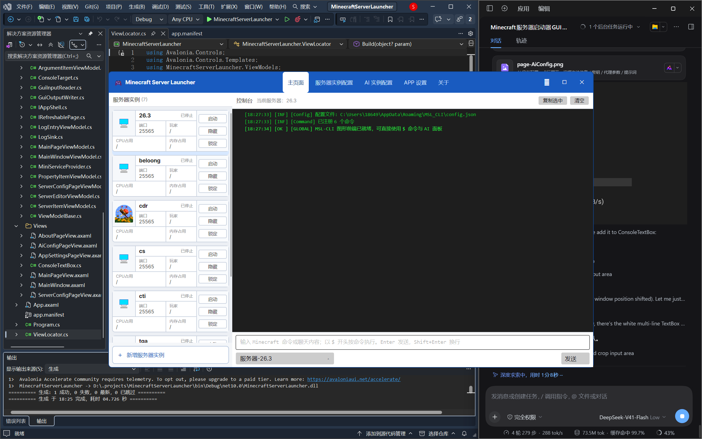
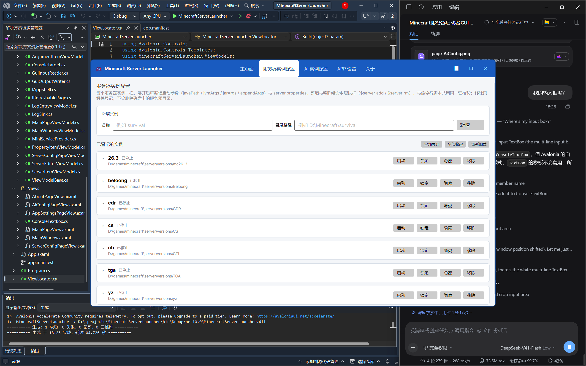
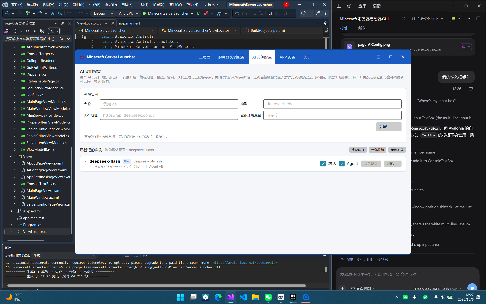
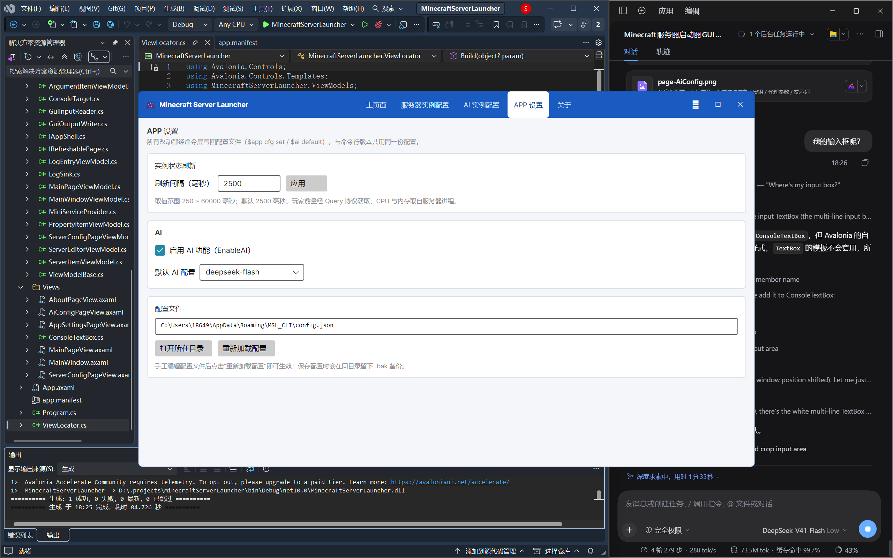
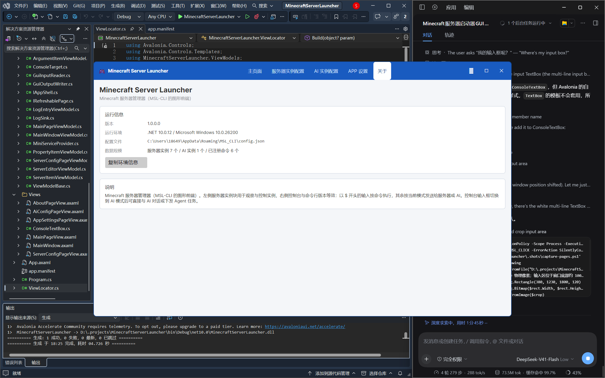

# Minecraft Server Launcher

**简体中文** | [English](README-EN.md) | [中文副本](README-CH.md)

一个基于 [Avalonia](https://avaloniaui.net/) 的 Minecraft 服务器启动器 / 管理器桌面应用。
它是 **MSL-CLI 的图形前端**：与命令行版本共用同一套命令、同一份配置文件与日志目录，
命令行里登记过的服务器可以直接在界面中管理。

[](https://dotnet.microsoft.com/)
[](https://avaloniaui.net/)
[](LICENSE)



---

## 目录

- [功能特性](#功能特性)
- [界面一览](#界面一览)
- [运行环境](#运行环境)
- [快速开始](#快速开始)
- [使用说明](#使用说明)
- [命令参考](#命令参考)
- [AI 与 Agent](#ai-与-agent)
- [配置文件与日志](#配置文件与日志)
- [项目结构](#项目结构)
- [从源码构建](#从源码构建)
- [开源协议](#开源协议)

---

## 功能特性

### 服务器管理

- **多实例登记**：`$server add <名称> <路径>` 登记任意数量的服务器目录，路径支持 `%VAR%` 环境变量。
- **进程启停**：一键启动 / 优雅停止，`stop -f` 可跳过优雅关闭直接结束进程树，避免残留 `java` 进程。
- **启动参数管理**：内建 `javaPath` / `jvmArgs` / `jarArgs` / `appendArgs` 四类启动参数，
  可从已有的 `start.bat` / `start.sh` 启动脚本中自动解析并重建启动行
  （`{javaPath} @user_jvm_args.txt {jarArgs} {appendArgs}`）。
- **控制台**：按服务器分流的实时输出，支持隐藏（`hd`）/ 显示（`uhd`）某实例的输出、高亮实例（`hl`）、
  读取输出缓冲区（`buf read`，缓冲区上限 512 KB）。
- **状态监控**：按配置间隔（默认 2500 ms，范围 250–60000 ms）轮询实例状态，
  玩家数量通过 Minecraft Query 协议获取，CPU 与内存来自服务器进程。
- **世界备份**：`$server bp <服务器名> [备注]` 备份世界目录。
- **名单检查**：白名单 / OP / 封禁玩家 / 封禁 IP 一键检查（`ck wl|op|bp|bip`）。
- **服务器配置**：图形界面直接编辑 `server.properties`，也可用 `$server cfg get|getall|set|rm`。
- **目录内文件操作**：读 / 写 / 追加 / 删除 / 复制 / 移动 / 列举（`$server file ...`）。
- **实例保护**：锁定（`lk`）后该实例的 `run` / `stop` / `send` / `rm` / `del` 一律被拒绝；
  删除目录需要显式 `confirm` 二次确认。

### 控制台与命令

- 输入以 `$` 开头按**命令**执行，其余内容按当前目标发送给**服务器**或**AI**。
- 目标由输入框前缀区分（`服务器-` / `AI-`），不再需要额外的模式切换按钮；
  AI 目标下可勾选 **Agent** 执行多步任务。
- 界面与命令行版本共用同一套命令、配置与日志，两个入口可以混用。
- 输入内容与日志着色一一对应命令行版本的 ANSI 颜色，可读性一致。

### AI 集成

- 支持多个 **OpenAI 兼容**服务实例，可在界面中增删改与即时生效（`$ai add` / `$ai rm`）。
- **Chat 模式**：普通问答，不挂载任何工具，模型不会执行命令。
- **Agent 模式**：模型可调用 `request_permission` / `execute_command` / `sleep` 三个工具完成多步任务；
  每条命令都必须先通过**授权网关**获得操作员许可，无法确认时一律拒绝。
- **授权白名单**：`$ai perm` 可查看 / 新增 / 删除授权范围，或对指定范围改为强制逐次询问。
- **上下文压缩**：估算 token 超过阈值（默认 32000）时先把较早的执行历史压缩成摘要再继续；
  最大迭代次数默认 16，防止无限循环。
- **游戏内对话**：玩家在服务器聊天里发送 `$chat` / `$agent` / `@ai` 指令即可与 AI 交互，
  授权提问也可以在游戏内作答（已做防伪造处理）。

### 其他

- 配置文件读取失败时自动回退默认值，原文件不被修改，并保留 `.bak` 备份。
- 全局 AI 开关、默认 AI 实例、状态刷新间隔等均可热更新（`$app cfg` / `$ai cfg`）。
- 每次操作都会写入界面日志与 `%APPDATA%\MSL_CLI` 下的文件日志。

---

## 界面一览

| 页面 | 截图 | 说明 |
| --- | --- | --- |
| 主页面 |  | 左侧服务器实例块（状态、玩家数、CPU / 内存），右侧控制台与日志 |
| 服务器配置 |  | 每个实例一栏：启动参数与 `server.properties` 可视化编辑 |
| AI 配置 |  | 多 AI 实例的地址 / 模型 / 密钥 / 提示词与授权管理 |
| 应用设置 |  | 全局开关、刷新间隔、配置文件路径等 |
| 关于 |  | 版本、运行环境、数据规模与问题反馈信息 |

> 截图位于 [`.shots/`](.shots/) 目录，由 [`.shots/capture-pages.ps1`](.shots/capture-pages.ps1) 生成。

---

## 运行环境

| 项目 | 要求 |
| --- | --- |
| 操作系统 | Windows 10/11（主要开发与验证平台）；Avalonia 本身支持跨平台 |
| 运行时 | [.NET 10.0](https://dotnet.microsoft.com/download)（目标框架 `net10.0`） |
| 依赖 | Avalonia 12.0.5、CommunityToolkit.Mvvm 8.4.1（NuGet 自动还原） |
| 运行服务器 | 需要自行准备 Java 运行环境与 Minecraft 服务端文件（本工具不下载服务端） |
| 可选 | Minecraft Query 协议需要在 `server.properties` 中开启 `enable-query` 才能读取玩家数 |

---

## 快速开始

1. 下载 / 构建并运行 `MinecraftServerLauncher.exe`。
2. 在控制台输入命令登记一个已有服务器目录：

   ```text
   $server add survival D:\mc\survival
   ```

3. 启动服务器：

   ```text
   $server run survival
   ```

4. 主界面左侧即出现该实例的状态卡片；在控制台直接输入内容（`服务器-` 前缀）即可向服务器发送命令。
5. 若需 AI 功能：在「AI 配置」页新增一个 OpenAI 兼容实例，
   然后 `$ai default <配置名>` 设为默认，或直接 `$ai agent <任务描述>`。

> 启动参数不匹配时用 `$server arg get <服务器名>` 查看、`$server arg set <服务器名> jvmArgs -Xms2G -Xmx4G` 修改。

---

## 使用说明

界面启动时可指定初始页面（页面名不区分大小写）：

```powershell
MinecraftServerLauncher.exe --page Main          # 主页面（默认）
MinecraftServerLauncher.exe --page ServerConfig  # 服务器配置
MinecraftServerLauncher.exe --page AiConfig      # AI 配置
MinecraftServerLauncher.exe --page AppSettings   # 应用设置
MinecraftServerLauncher.exe --page About         # 关于
```

控制台输入的语义：

| 输入 | 行为 |
| --- | --- |
| `$server ls` | 以 `$` 开头 → 按命令执行（与命令行版本一致） |
| `list` | 不以 `$` 开头 + `服务器-` 目标 → 作为 Minecraft 命令发送给服务器 |
| `帮我看下服务器状态` | 不以 `$` 开头 + `AI-` 目标 → 作为对话消息发给 AI |
| 勾选 **Agent** 后发送 | 作为 Agent 任务下发，模型可多步调用命令（需逐条授权） |

---

## 命令参考

命令与 MSL-CLI 完全一致，`$help [命令名]` 可查看单个命令的详细用法。

| 命令 | 说明 |
| --- | --- |
| `$list` | 只列出全部命令名（不含说明） |
| `$help [命令名]` | 查看命令帮助；不带参数时列出全部命令与说明 |
| `$server ...` | 服务器实例管理（登记、启停、配置、备份、文件、状态等） |
| `$ai ...` | AI 对话 / 代理执行、AI 实例与授权管理 |
| `$app ...` | 应用级操作：执行系统命令、读写全局配置、退出 / 重载 |
| `$file ...` | 文件操作，仅限白名单目录，支持 `%appdata%`、`%<服务器名>%` 占位符 |

`$server` 的主要动作：

```text
add <名称> <路径>                        登记新服务器
rm <名称>                                只移除配置引用（保留目录）
del <名称> confirm                       移除引用并删除整个服务器目录（不可恢复）
lk|ulk <名称>                            锁定 / 解锁
hd|uhd <名称>                            隐藏 / 显示该实例的控制台输出
hl [名称]                                查看 / 切换高亮服务器
file -r|-w|-a|-rm|-cp|-mv|-ls ...        服务器目录内文件操作
cfg get|getall|set|rm [服务器名] [键] [值]   server.properties 读写
arg get|set|rm <服务器名> <参数> [值...]   启动参数（javaPath/jvmArgs/jarArgs/appendArgs）
ck wl|op|bp|bip <服务器名|all> [名称]      名单检查
buf read|update <服务器名>                读取 / 读取并清空输出缓冲区
ls                                       列出所有服务器及状态
bp <服务器名> [备注]                      备份世界目录
query <服务器名|all>                      Query 协议查询
status [服务器名|all]                     进程状态
stop <服务器名|all> [-f]                  停止（-f 强制终止）
run <服务器名>                            启动
send <服务器名|all> <命令>                发送 Minecraft 命令
```

---

## AI 与 Agent

```text
$ai chat|agent [配置名] <消息>    对话 / 代理执行（省略配置名时用 DefaultAIConfig）
$ai default [配置名]              查看 / 设置默认 AI 配置
$ai add <配置名> <Url> <Model> [ApiKeyEnv]
$ai rm <配置名>
$ai cfg get [路径] | getall | set <路径> <值> | rm <路径>
$ai perm [get|add|rm|ask|noask] [范围]
```

- **Chat 模式**不挂载工具，模型只回答，不会执行任何命令。
- **Agent 模式**下模型只能通过 `execute_command` 执行 `$` 开头的命令，
  且必须先经 `request_permission` 获得操作员允许；已加入白名单的范围可直接执行。
- 授权范围为命令名或「命令名 + 子动作」（例如 `$server`、`$server run`），
  支持 `ask`（逐次询问）与 `noask`（不再询问）切换。
- API 密钥默认从环境变量读取（可用 `$ai add` 的 `ApiKeyEnv` 参数指定变量名），
  也可在配置中直接填写。

游戏内使用时，玩家在聊天框发送：

```text
$chat 你好                       # 与默认 AI 对话
$agent 把天气改成晴天             # 下发 Agent 任务
@ai <配置名> chat|agent 内容     # 指定 AI 实例
```

---

## 配置文件与日志

| 路径 | 内容 |
| --- | --- |
| `%APPDATA%\MSL_CLI\config.json` | 全局配置：`EnableAI`、`AIConfigs`、`ServerPaths`、`LockedServers`、`HiddenServers`、`DefaultAIConfig`、`StatusQueryIntervalMs`、`AgentPermissions` |
| `%APPDATA%\MSL_CLI\config.json.bak` | 每次写入前的备份 |
| `%APPDATA%\MSL_CLI\config.json.corrupt` | 读取失败时被隔离的原始文件 |
| `%APPDATA%\MSL_CLI\` 下的日志目录 | 运行日志文件 |

界面版与命令行版共用以上路径，因此两边登记的内容可以互相识别。

---

## 项目结构

```text
MinecraftServerLauncher/
├─ Models/
│  ├─ Domain/            领域模型（AppConfig、AIConfig、ServerProperties、权限、聊天解析…）
│  ├─ Ports/             接口（IServer、IAgentService、IConfigurationStore…）
│  ├─ UseCases/          用例（CommandExecutor）
│  ├─ Infrastructure/    实现（ServerManager、AgentService、OpenAi、Query、Commands…）
│  └─ Cli/               命令行输入 / 输出实现
├─ ViewModels/           MVVM 视图模型（各页面 + 应用外壳）
├─ Views/                Avalonia 视图（.axaml）
├─ Assets/               图标等资源
├─ .shots/               界面截图与截图脚本
├─ App.axaml(.cs)        应用入口与启动页解析
└─ Program.cs            Avalonia 引导
```

---

## 从源码构建

```powershell
# 还原并构建
dotnet build MinecraftServerLauncher.csproj -c Release

# 直接运行
dotnet run --project MinecraftServerLauncher.csproj

# 发布为依赖框架的可执行文件
dotnet publish MinecraftServerLauncher.csproj -c Release -r win-x64 --self-contained false
```

生成的程序位于 `bin\Release\net10.0\`（`publish` 则在对应的 `publish\` 目录下）。

---

## 开源协议

本项目基于 [MIT License](LICENSE) 开源，Copyright (c) 2026 LJK0890。
